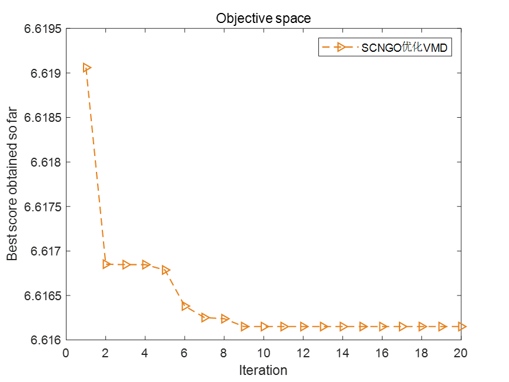
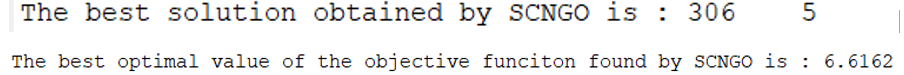
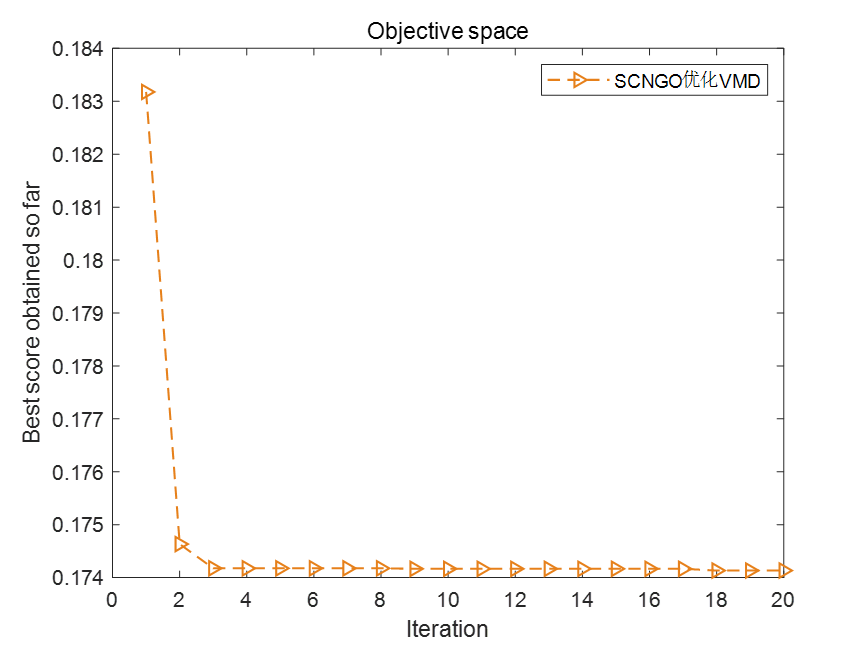
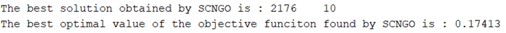
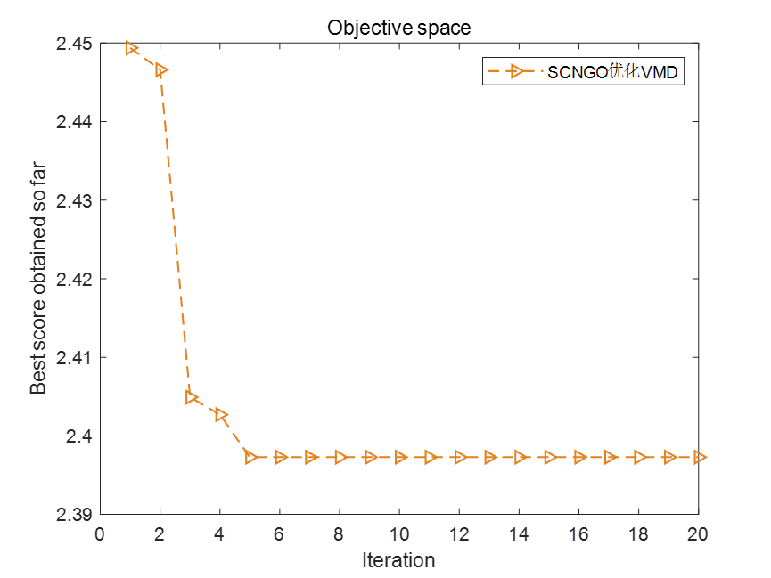
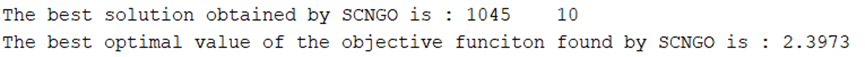
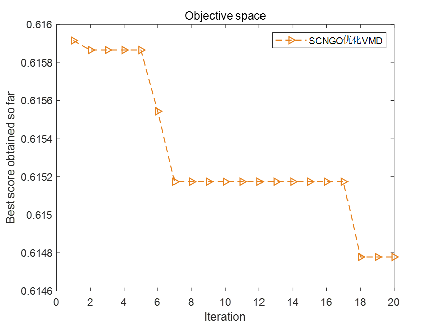
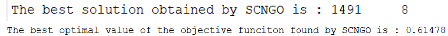

# Improved Northern Eagle Algorithm Optimization for VMD Parameters, Minimizing Entropy (Sample Entropy, Information Entropy, Arrangement Entropy) (Adaptation function can be selected by one-click modification). Includes MATLAB source code.

Today, we bring you a session on optimizing two parameters of the VMD (Vector Modulus Decomposition) algorithm using an improved version of the Northern Crowded Oriented Search (SCNGO) algorithm. 
Taking the Xichu University dataset as an example, we selected 1000 data points from X105_BA_time.mat in the 105.mat file. If there are no data points, please refer to this article. Xichu University Bearing Diagnosis Data Processing with MATLAB Free Code 
We chose four fitness functions for optimization, aiming to determine the optimal k and α parameters of the VMD. The four fitness functions are: minimum entropic modulus, minimum sample entropy, minimum information entropy, and minimum permutation entropy. The code allows for one-click switching between these functions. As for which one to choose as your own fitness function, you can refer to this article. Why does VMD need parameter optimization? Which among minimum entropic modulus/sample entropy/permutation entropy/information entropy should be chosen as the fitness function?
1. Minimize Entropic Modulus as the fitness function
2. Minimize Sample Entropy as the fitness function
3. Minimize Information Entropy as the fitness function
4. Minimize Permutation Entropy as the fitness function
Code:
%% Optimize VMD using SCNGO algorithm with minimum entropies as objective functions (choose one of them), and find the optimal two parameters for VMD.\nclear\nclc\nclose all\nxz = 3;  %xz=1 or 2, choose 1 with minimum entropic envelope fitness function, choose 2 with minimum sample entropy fitness function, choose 3 with minimum information entropy fitness function, choose 4 with minimum permutation entropy fitness function\nif xz == 1  \n    fobj=@EnvelopeEntropyCost;          % Minimum Entropy\nelseif xz == 2\n    fobj=@SampleEntropyCost;            % Minimum sample entropy\nelseif xz == 3\n    fobj=@infoEntropyCost;              % Minimum Information Entropy\nelseif xz == 4\n    fobj=@PermutationEntropyCost;       % Minimum Arrangement Entropy\nend\n\n%% Select data\nload 105.mat\nda = X105_DE_time(6001:7000); % Here, select the DEtime data of 105, note that you can replace it with your own data. The data format is n rows * 1 column, and the number of columns must be 1.\n\n%% Set parameters\nlb = [100 3];    % Penalty factor and the lower bound of K\nub = [2500 10];  % Penalty factor and the upper limit of K\ndim = 2;            % Optimize the number of variables\nMax_iter=20;       % Maximum number of iterations\nSearchAgents_no=20;       %Population size\n\n%% Call SCNGO function\n[fMin , bestX, Convergence_curve ] = SCNGO(SearchAgents_no,Max_iter,lb,ub,dim,fobj,da);\n\n%% Plot the fitness function curve and output the optimal parameters.\nfigure\nplot(Convergence_curve,'Color',[0.9 0.5 0.1],'Marker','>','LineStyle','--','linewidth',1);\ntitle('Objective space')\nxlabel('Iteration');\nylabel('Best score obtained so far');\nlegend('SCNGOOptimizationVMD')\ndisplay(['The best solution obtained by SCNGO is : ', num2str(round(bestX))]);  % Output the best location\ndisplay(['The best optimal value of the objective funciton found by SCNGO is : ', num2str(fMin)]);  % Output the best fitness value\nEveryone, pay attention to see.xzThis variable, when selected.1, Using the minimal entropic fitness function, select.2, Using the minimum sample entropy as the fitness function, select.3, The fitness function is the minimum information entropy, and selection is made.4, Use the minimum permutation entropy as the fitness function. This makes it very convenient for everyone to switch.。  
Complete code obtained, backend reply keyword:  
SCNGOVMD

## Images

<!-- PAYMENT_BLOCK -->

## Get this dataset

- Payment link (Stripe): [Buy now](https://buy.stripe.com/3cs8yP7sY87d0vu9AB)
- Payment QR code: 

<!-- /PAYMENT_BLOCK -->
